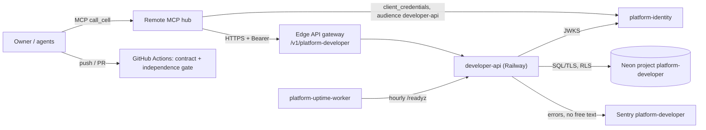
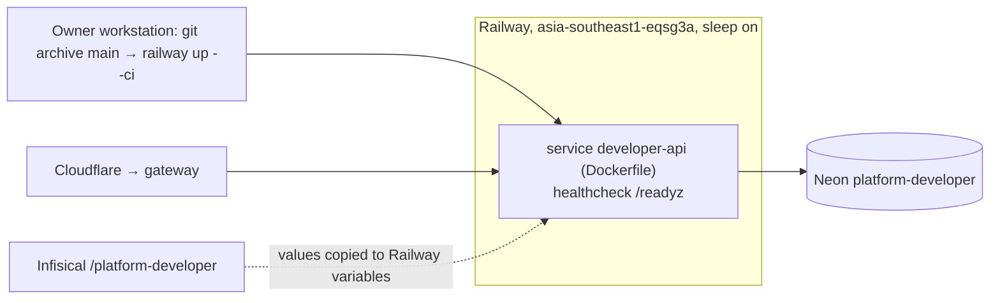

# Book Developer Platform — System Architecture

เอกสารนี้สรุปสถาปัตยกรรมของ `platform-developer` จากโค้ดและ config ที่ `origin/main` `05ba151` (runtime ที่ live ตาม ops record คือ `6ffbb1f`) repo นี้มีสองส่วน: (1) **contract + offline gate** ของ capability `developer` (repository templates, CI/CD, config, feature flags) และ (2) **feature-flag runtime pilot** `developer-api` รายละเอียดเชิงลึกอยู่ใน Core 22 diagram pack [`docs/diagrams/`](../docs/diagrams/README.md)

## 1. Architecture style และเหตุผล

**Style:** contract-first boundary repo + service เล็กหนึ่ง process (FastAPI) บน shared library `platform-backend-core` ที่ pin ด้วย commit; flag เก็บต่อ workspace ใน PostgreSQL forced RLS; deploy เป็น serverless container

เหตุผลที่เห็นจากหลักฐาน:

- capability `developer` ส่วนใหญ่ (templates, CI/CD) ยังอยู่ใน `.github` ของ control plane (`contract.json` `current_implementation.source_path: .github`); repo นี้ถือ contract และ gate BOO-155 "templates และ boundary checks ต้องไม่พึ่ง product source" ([docs/gates/BOO-155-template-independence.md](../docs/gates/BOO-155-template-independence.md))
- feature flags เป็นส่วนที่มี runtime จริง เพราะต้องการ state ต่อ workspace และ API กลาง — จึงใช้ core เดียวกับอีก 7 service ([ADR-0001](../docs/diagrams/08-adr/ADR-0001-fastapi-on-pinned-platform-backend-core.md))
- แก้ flag แบบ optimistic concurrency (`version`) แทน lock ยาว เพราะ write น้อยและ caller เป็น agent/MCP

## 2. Quality-attribute scenarios

| ID | Attribute | Stimulus → Response | Measure | หลักฐาน |
|---|---|---|---|---|
| QA-01 | Security (isolation) | token workspace A อ่าน flag ของ B | ไม่เห็น (RLS) | `migrations.py` FORCE RLS + policy `workspace`; `runtime_tests/test_runtime.py`, `test_http.py` |
| QA-02 | Security (authz) | ไม่มี token / scope ไม่พอ | 401 / 403 | `app.py` `require_scope('flags:read'|'flags:write')` |
| QA-03 | Consistency | สอง caller แก้ flag เดียวกันด้วย `version` เดิม | อันหนึ่งสำเร็จ อีกอัน 409 Conflict | `store.py` `UPDATE ... WHERE version=%s`, `delete(..., version)` |
| QA-04 | Determinism | evaluate flag เดิมด้วย subject เดิมซ้ำ | ผลเท่าเดิม (rollout 0–10000 basis points, hash) | `store.py` (`hashlib`), `migrations.py` CHECK rollout |
| QA-05 | Availability (cold start) | request แรกหลัง sleep + Neon suspend | ภายใน pool wait 20 s; warm `/readyz` ~0.9 s (วัด 2026-11-04) | core `db.py`@21d5f44, `runtime_tests/test_pool_reuse.py` |
| QA-06 | Privacy | exception มี subject id | Sentry ไม่มี free text | [ADR-0005](../docs/diagrams/08-adr/ADR-0005-sentry-no-free-text.md), `runtime_tests/test_sentry.py` |
| QA-07 | Independence | template/check import product repo หรือ hard-code sibling path | CI fail | `scripts/check_independence.py`, `tests/test_independence.py`, `fixtures/gates/template-independence.json` |
| QA-08 | Reproducible build | core resolve เป็น commit อื่นจากที่ review | test fail | `runtime_tests/test_build_pin.py` |

## 3. Context diagram

ภาพ C4 เต็ม: [05-c4-context.md](../docs/diagrams/05-c4-context.md). `contract.json` `depends_on: security, observability` แต่ไม่มี call ไป security ใน `src/` **[ต้องยืนยัน]** ว่าตั้งใจเป็น dependency ในอนาคต

## 4. Components / containers

| Container | เทคโนโลยี | หน้าที่ | หลักฐาน |
|---|---|---|---|
| `developer-api` (serve) | Python 3.12, FastAPI, uvicorn, `platform-backend-core@21d5f44` | `/v1/flags` list/get/put/delete/evaluate + probes, PORT 8080, UID 65532 | `Dockerfile`, `__main__.py`, `app.py` |
| migrate one-off | image เดียวกัน | DDL ด้วย DDL role, advisory locks | `__main__.py`, `migrations.py` |
| Neon PostgreSQL | Postgres (CI 16) | `feature_flags`, `platform_schema_migrations` | `migrations.py` |
| Offline gate | Python scripts | contract check, schema pin, template independence | `scripts/check.sh`, `scripts/check_independence.py` |

Components ([07-c4-component.md](../docs/diagrams/07-c4-component.md)): core `_Boundary` (body ≤ 32 KiB, timeout 30 s, redacted 500) → `CaptureErrors` (`_sentry.py`) → routes (`app.py`) → `require_scope`/`TokenVerifier` (core) → `FlagStore` (`store.py`: put/get/list/delete/evaluate/ready) → core `Database` (pool max 8, ตั้ง `app.workspace_id`)

## 5. Tech stack

| ชั้น | เทคโนโลยี | หลักฐาน |
|---|---|---|
| Runtime | Python ≥ 3.12, FastAPI/psycopg/PyJWT ผ่าน core, uvicorn `>=0.34,<1`, `sentry-sdk>=2.72,<3`, `httpx>=0.28,<1` | `pyproject.toml` |
| Shared library | `platform-backend-core==0.1.0` pin rev `21d5f44d…` | `pyproject.toml`, `uv.lock` |
| Build | Dockerfile `python:3.12-slim`, non-root | `Dockerfile` |
| Quality | uv locked, Ruff, mypy, pytest บน PostgreSQL 16 + coverage gate 90%, security scans | `.github/workflows/check.yml` |

`httpx` อยู่ใน runtime dependencies แต่ไม่พบการใช้ใน `src/` (ใช้ใน test) — ดูคำถามค้าง

## 6. Data stores

| Store | ข้อมูล | กฎ | หลักฐาน |
|---|---|---|---|
| Neon `platform-developer` | `feature_flags(workspace_id, name, enabled, rollout 0–10000, subjects jsonb, version)` PK `(workspace_id, name)` | ENABLE + FORCE RLS; runtime role NOSUPERUSER NOBYPASSRLS มีแค่ SELECT/INSERT/UPDATE/DELETE | `migrations.py`, [09-erd.md](../docs/diagrams/09-erd.md), [ADR-0002](../docs/diagrams/08-adr/ADR-0002-postgresql-forced-rls-and-split-roles.md) |

ไม่มี cache, R2 หรือ queue

## 7. Integrations

| ระบบ | ทิศทาง | ใช้ทำอะไร | สถานะ | หลักฐาน |
|---|---|---|---|---|
| platform-identity (JWKS) | API → identity | RS256, audience `developer-api`, scopes `flags:read`, `flags:write` | live | `__main__.py`, [ADR-0003](../docs/diagrams/08-adr/ADR-0003-rs256-workspace-jwt-with-scopes.md) |
| Edge API gateway | gateway → API | route `platform-developer` (unauth call ผ่าน gateway → 401, ตรวจ 2026-11-04) | live | `platform-api-gateway@51c4711` `routes.json` |
| Remote MCP hub | hub → gateway → API | cell `platform-developer`, `flags:read`/`flags:write` | live | `platform-mcp-remote-worker@7d127c2` `PLATFORM_CELLS`, `CELLS` |
| Neon / Sentry / uptime worker | ตาม context | DB, errors, hourly `/readyz` | live | `__main__.py`, `_sentry.py`, ops record |
| platform-security | — | ใน `depends_on` แต่ไม่มี call | ไม่มีใน code | `contract.json` |
| R2, queues/Kafka | — | not_applicable | — | ไม่มีใน `src/` |

## 8. Deployment topology

- Env (ชื่อเท่านั้น): `DATABASE_URL`, `JWT_ISSUER`, `JWT_AUDIENCE`, `JWT_JWKS_URL`/`JWT_PUBLIC_KEY`, `PORT`, `SENTRY_DSN`, `SENTRY_ENVIRONMENT`, `SENTRY_RELEASE` ([16-deployment.md](../docs/diagrams/16-deployment.md))
- Live URL `https://developer-api-production-2fad.up.railway.app`, `/readyz` 200 ใน 0.91 s (ตรวจ 2026-11-04); deploy เป็น CLI ไม่ผูก CI ([ADR-0004](../docs/diagrams/08-adr/ADR-0004-railway-dockerfile-serverless.md))

## 9. ADR สำคัญ

| ADR | การตัดสินใจ |
|---|---|
| [ADR-0001](../docs/diagrams/08-adr/ADR-0001-fastapi-on-pinned-platform-backend-core.md) | FastAPI บน `platform-backend-core` ที่ pin |
| [ADR-0002](../docs/diagrams/08-adr/ADR-0002-postgresql-forced-rls-and-split-roles.md) | PostgreSQL forced RLS + แยก DDL/runtime role |
| [ADR-0003](../docs/diagrams/08-adr/ADR-0003-rs256-workspace-jwt-with-scopes.md) | RS256 workspace JWT พร้อม scopes |
| [ADR-0004](../docs/diagrams/08-adr/ADR-0004-railway-dockerfile-serverless.md) | Railway Dockerfile serverless |
| [ADR-0005](../docs/diagrams/08-adr/ADR-0005-sentry-no-free-text.md) | Sentry ไม่ส่ง free text |

## 10. Fitness functions (ที่มีอยู่แล้ว)

| Fitness function | ปกป้องอะไร | รันที่ |
|---|---|---|
| `scripts/check.sh`: contract check, `check_schema_pin.py`, `check_independence.py` + `tests/test_independence.py` | contract valid, gate BOO-155 (ไม่ import/hard-code product source) | CI `contract` (Py 3.11, 3.12) |
| `tests/test_build_hygiene.py`, `runtime_tests/test_build_pin.py` | core pin ตรงกัน, build reproducible | CI `python` |
| `runtime_tests/test_runtime.py`, `test_http.py`, `test_error_mapping.py`, `test_pool_reuse.py` บน PostgreSQL จริง | RLS, version conflict, error contract, pool | CI `python` |
| `runtime_tests/test_sentry.py` | ไม่มี free text ออกจาก process | CI `python` |
| Coverage gate 90% | ไม่ลด coverage | CI `python` |
| `shared-runtime.yml`, `security.yml` | image build non-root; secret/dependency scans | CI |
| `/readyz` (`flags_schema`) | DB ตรงกับ code | Railway healthcheck + uptime worker |

## 11. เอกสารลงรายละเอียด (SDLC phase 07)

| Template | สถานะ | ไฟล์ / เหตุผล |
|---|---|---|
| infrastructure-and-network-design | partial | [16-deployment.md](../docs/diagrams/16-deployment.md), [13-threat-model.md](../docs/diagrams/13-threat-model.md) |
| observability-design | partial | [20-observability.md](../docs/diagrams/20-observability.md); ไม่มี SLO/alert |
| capacity-performance-and-cost-plan | not_applicable | tier L0, ไม่มี consumer/traffic; free tier |
| failure-mode-analysis | partial | [14-backup-dr.md](../docs/diagrams/14-backup-dr.md), [21-incident-response.md](../docs/diagrams/21-incident-response.md) |
| async-integration-contract | not_applicable | ไม่มี queue/webhook/job |
| frontend-architecture | not_applicable | ไม่มี UI |
| tech-debt-register | partial | open questions ใน [docs/diagrams/README.md](../docs/diagrams/README.md), [docs/UPGRADE-PLAN.md](../docs/UPGRADE-PLAN.md) |
| system-landscape | external | อยู่ใน landscape ของ portfolio **[ต้องยืนยัน]** |
| vendor-dependency-review (lock-in) | missing | Railway, Neon, Sentry |

## 12. คำถามค้าง

- Q-01: `PRODUCT.md` ยังเขียน "not deployed" และ "Sentry does not apply" ขัดกับสถานะ live + Sentry (ops record, `/readyz` 200) — อัปเดตเมื่อไร และ boundary status ควรยังเป็น `scaffolded` หรือไม่
- Q-02: `httpx` เป็น runtime dependency ที่ไม่ได้ใช้ใน `src/` — ย้ายไป test extra ได้หรือไม่
- Q-03: `depends_on: security` หมายถึงอะไร (ยังไม่มี call)
- Q-04: จะปิด direct Railway URL ให้รับเฉพาะจาก gateway เมื่อไร
- Q-05: Neon `platform-developer` อยู่ใน backup + restore drill หรือไม่; RTO/RPO
- Q-06: ส่วน templates/CI-CD ของ capability จะย้ายออกจาก `.github` ของ control plane มาที่ repo นี้หรือไม่ (ตอนนี้มีแค่ gate)

## การอนุมัติ

| บทบาท | สถานะ | วันที่ | ลงนาม |
|---|---|---|---|
| Solution Architect (Book Dev) | รอตรวจ | — | [ต้องยืนยัน] |
| Owner | รอตรวจ | — | [ต้องยืนยัน] |

## แหล่งข้อมูล

- repo `bookchaowalit-backend/platform-developer` `origin/main` `05ba151` (live runtime ตาม ops record `6ffbb1f`)
- `PRODUCT.md`, `README.md`, `contract.json`, `docs/runtime.md`, `docs/CONTRACT-SURFACE.md`, `docs/UPGRADE-PLAN.md`, `docs/gates/BOO-155-template-independence.md`, `fixtures/gates/template-independence.json`
- `pyproject.toml`, `uv.lock`, `Dockerfile`, `.railway/railway.ts`, `.github/workflows/check.yml`, `.github/workflows/shared-runtime.yml`, `scripts/check.sh`, `scripts/check_independence.py`
- `src/platform_developer/{__main__,app,store,migrations,_sentry}.py`, `tests/`, `runtime_tests/`
- `docs/diagrams/` (Core 22 pack, commit `05ba151`) และ `docs/diagrams/08-adr/ADR-0001…0005`
- `bookchaowalit-backend/platform-api-gateway@51c4711` `routes.json`; `bookchaowalit/platform-mcp-remote-worker@7d127c2` `src/worker.ts`, `wrangler.toml`
- ops record: book-platforms-status, api-gateway-edge (2026-11-03); `curl /readyz` 2026-11-04
