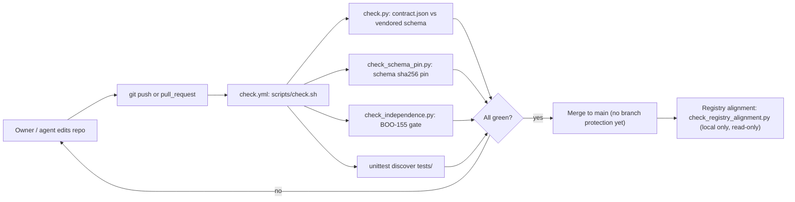
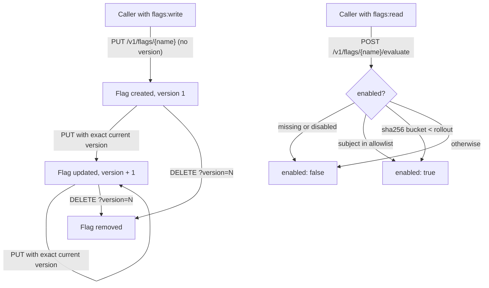
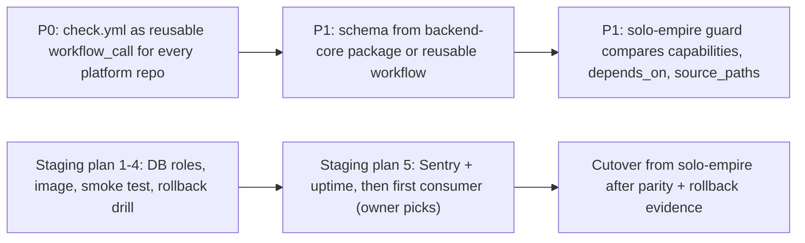

# 01 — Business process (As-Is / To-Be)

Repository นี้มีสองกระบวนการที่เห็นได้จากโค้ดวันนี้:

1. **Boundary contract gate** — ทุก push/PR ต้องผ่าน `scripts/check.sh` (contract, schema pin, independence gate, unit tests) เพื่อให้ `developer` capability ย้ายออกจาก `solo-empire` ได้ภายหลังโดย consumer ไม่รู้ตัว
2. **Feature-flag runtime pilot** — workspace เก็บ feature flag ใน PostgreSQL (forced RLS) แล้ว caller ประเมิน (evaluate) flag ต่อ subject แบบ deterministic

## As-Is: contract gate (จากโค้ด)

Sources: `scripts/check.sh`, `.github/workflows/check.yml`, `scripts/check_registry_alignment.py`, `docs/gates/BOO-155-template-independence.md`, `README.md`

## As-Is: feature-flag lifecycle (จากโค้ด)

Sources: `src/platform_developer/app.py`, `src/platform_developer/store.py`, `docs/runtime.md` (Flag API)

## To-Be (จาก PRODUCT.md / docs/UPGRADE-PLAN.md / docs/runtime.md เท่านั้น)

Sources: `docs/UPGRADE-PLAN.md` (Backlog P0/P1/P2), `docs/runtime.md` (Staging plan), `PRODUCT.md` (Measures, Capabilities and Constraints)

## Open questions

- PRODUCT.md ระบุ "[ต้องยืนยัน] The cutover criteria for activating the runtime" — ยังไม่มีเกณฑ์ cutover
- consumer แรกของ flag API คือใคร (runtime.md step 5: "owner to pick")
- ยังไม่มี issue หรือ spec ที่กำหนด To-Be ของ feature-flag เกิน PR #1 (targeting rules, audit history, SDK caching ถูกระบุว่า "not done")
