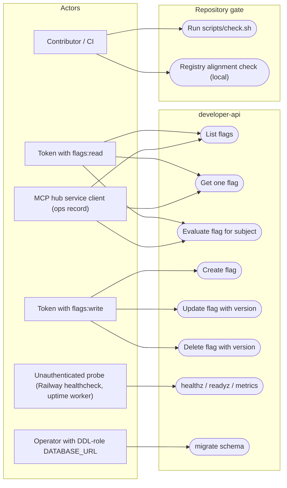

# 02 — Use cases

Actors คือสิทธิ์ที่ service ตรวจจริง ไม่ใช่หน้า UI: token RS256 ที่ `TokenVerifier` ยอมรับ (issuer + audience จาก env, ต้องมี `sub`, `ws`, `iat`, `exp`, `jti`) และ scope ใน claim `scope` ที่ `require_scope` ตรวจ (`flags:read`, `flags:write`) โดย workspace มาจาก `ws` เท่านั้น ส่วน probe endpoints ไม่ต้องใช้ token

Sources: `src/platform_developer/app.py`, `src/platform_developer/__main__.py`, `scripts/check.sh`, `scripts/check_registry_alignment.py`, core `platform_backend_core/auth.py` + `http.py` (pinned commit `21d5f44`, see `pyproject.toml`), ops record: book-platforms-status (2026-11-03)

หมายเหตุ: token ที่มีทั้งสอง scope (`flags:read flags:write`) ทำได้ทุก use case ของ API — tests ใช้แบบนั้น (`runtime_tests/test_http.py`). Token ที่มี claim `del` หรือ `obo` (delegation) ถูกปฏิเสธเสมอ

## Open questions

- MCP hub ถือ scope ใดของ developer (`flags:read` อย่างเดียว หรือ `flags:write` ด้วย) — ops record บอกเพียงว่า call_cell developer ได้ 200
- person token (Google login ผ่าน identity) ยังเปิดไม่ได้จนกว่า owner ตั้ง `IDENTITY_GOOGLE_CLIENT_IDS` (ops record) — ยังไม่มี person caller จริง
- ไม่มี role "owner" แยกในโค้ด service นี้: สิทธิ์ทั้งหมดคือ scope ต่อ workspace
