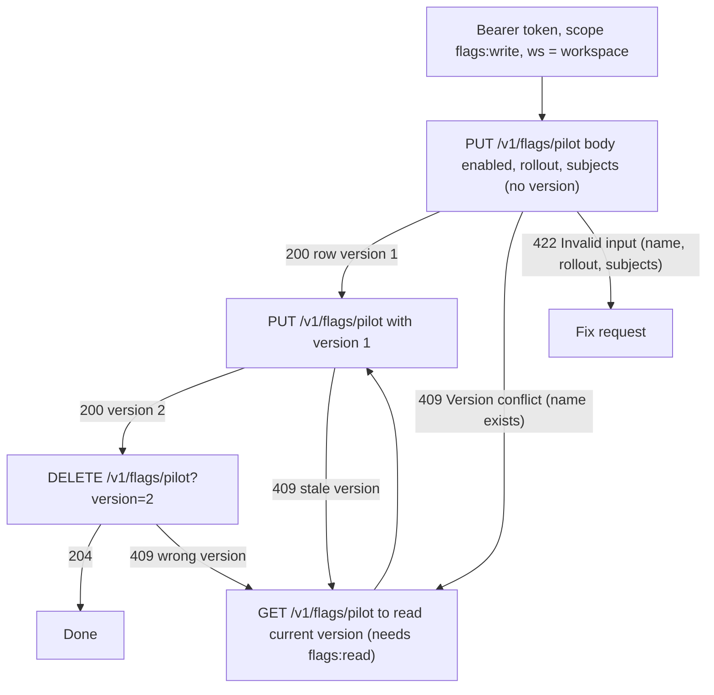
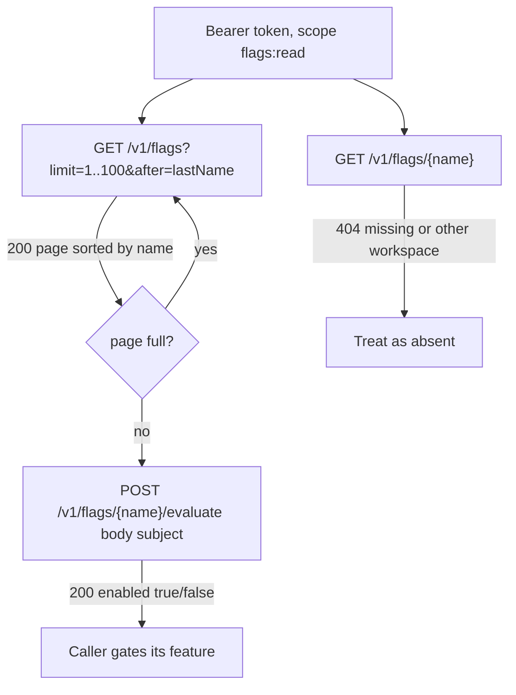
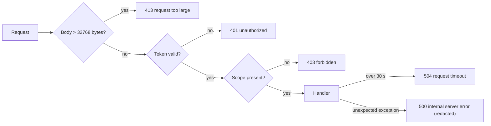

# 03 — User flows (API call flows per caller)

Service นี้ไม่มีหน้าเว็บ "user flow" จึงเป็นลำดับการเรียก API ของแต่ละ caller

## Writer (flags:write): create → update → delete

## Reader (flags:read): list and evaluate

## Error branches common to every call

Sources: `src/platform_developer/app.py`, `src/platform_developer/store.py`, core `platform_backend_core/http.py` (`_Boundary`, `require_scope`), `runtime_tests/test_http.py`, `runtime_tests/test_error_mapping.py`, `docs/runtime.md`

หมายเหตุ: evaluate ของ flag ที่ไม่มีอยู่คืน `{"enabled": false}` (200) ไม่ใช่ 404 — `store.evaluate` คืน False เมื่อ row เป็น None

## Open questions

- ยังไม่พบ consumer จริงที่เรียก evaluate ในงาน production (ดู 01 To-Be)
