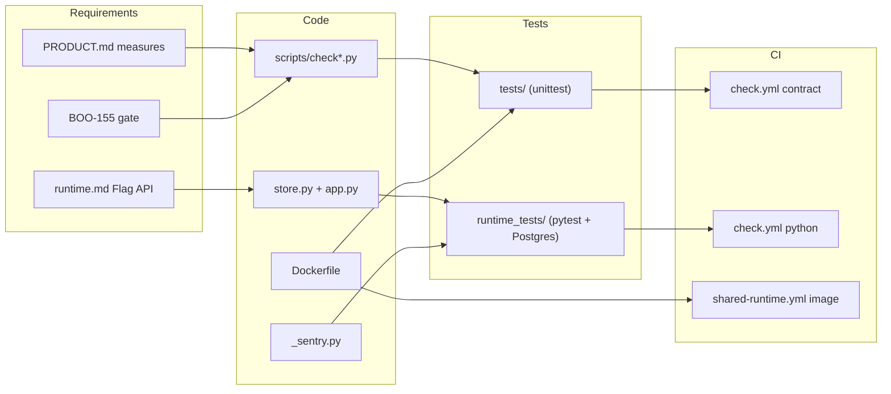

# 04 — Traceability (RTM)

Requirement มาจาก `PRODUCT.md`, `docs/runtime.md` (Flag API, lifecycle), `docs/gates/BOO-155-template-independence.md` และ `docs/CONTRACT-SURFACE.md` (repo นี้ไม่มี `specs/`)

| ID | Requirement (source) | Code module | Test file | Workflow / release |
|---|---|---|---|---|
| R1 | contract.json valid against pinned schema (PRODUCT.md Measures) | `scripts/check.py` | `tests/test_contract_check.py` | `check.yml` job `contract` (3.11, 3.12) |
| R2 | vendored schema matches canonical sha256 pin (README) | `scripts/check_schema_pin.py` | `tests/test_drift_checks.py` (SchemaPinTests) | `check.yml` `contract` |
| R3 | registry entry matches contract, drift = 0 (PRODUCT.md Measures) | `scripts/check_registry_alignment.py` | `tests/test_drift_checks.py` (RegistryAlignmentTests) | local only, not in CI |
| R4 | templates and checks independent of product source (BOO-155) | `scripts/check_independence.py`, `fixtures/gates/template-independence.json` | `tests/test_independence.py` | `check.yml` `contract` |
| R5 | every interface in contract.json documented (CONTRACT-SURFACE) | `scripts/check.py` | `tests/test_contract_check.py::test_undocumented_interface_fails` | `check.yml` `contract` |
| R6 | flag create / exact-version update / 409 on stale (runtime.md Flag API) | `store.py` `FlagStore.put`, `app.py` `put` | `runtime_tests/test_runtime.py`, `runtime_tests/test_http.py` | `check.yml` job `python` (Postgres) |
| R7 | delete needs exact version (runtime.md) | `FlagStore.delete` | `runtime_tests/test_runtime.py::test_delete_version_and_force_rls` | `python` |
| R8 | deterministic sha256 bucket rollout + allowlist (runtime.md) | `FlagStore.evaluate` | `runtime_tests/test_runtime.py::test_rollout_version_and_tenant_isolation` | `python` |
| R9 | workspace isolation via forced RLS; cross-workspace = 404 (runtime.md) | `migrations.py` 0001, core `Database.transaction` | `test_runtime.py`, `test_http.py`, `test_pool_reuse.py` | `python` |
| R10 | scope auth: 401 / 403 (runtime.md) | core `require_scope`, `app.py` | `runtime_tests/test_http.py::test_authenticated_flag_api_conflict_and_bounds` | `python` |
| R11 | readiness checks migrations checksum + each privilege + RLS (runtime.md) | `FlagStore.ready`, core `readyz` | `runtime_tests/test_http.py` (readiness tests) | `python`; Railway healthcheck `/readyz` (`.railway/railway.ts`) |
| R12 | only InvalidInput maps to 422, other errors redacted 500 (runtime.md follow-ups) | `store.py` `InvalidInput`, `app.py` handlers | `runtime_tests/test_error_mapping.py` | `python` |
| R13 | migrate is a separate CLI command, never at startup (runtime.md) | `__main__.py` | `runtime_tests/test_http.py::test_documented_cli_migrate_makes_http_ready` | `python` |
| R14 | image builds from clean checkout, non-root, CMD serve (runtime.md Container image) | `Dockerfile`, `.dockerignore` | `tests/test_build_hygiene.py` | `shared-runtime.yml` job `image` |
| R15 | core pinned to reviewed commit in workflow, Dockerfile, uv sources (runtime.md) | `pyproject.toml`, `Dockerfile` | `runtime_tests/test_build_pin.py`, `tests/test_build_hygiene.py` | `python`, `image` |
| R16 | Sentry sends no free text, no PII (module docstring, ops record) | `_sentry.py` | `runtime_tests/test_sentry.py` | `python`; deploy = manual CLI |
| R17 | all workflow actions SHA-pinned (runtime.md) | `.github/workflows/*.yml` | `tests/test_build_hygiene.py` (WorkflowPinTests) | `contract` |
| R18 | coverage ≥ 90% (check.yml ratchet, ADR-0004) | — | whole pytest suite | `python` `coverage-threshold: "90"` |

Sources: `PRODUCT.md`, `docs/runtime.md`, `docs/CONTRACT-SURFACE.md`, `docs/gates/BOO-155-template-independence.md`, `.github/workflows/check.yml`, `.github/workflows/shared-runtime.yml`, `.railway/railway.ts`, files listed in the table

## Open questions

- ไม่มี release tag หรือ release workflow: "release" ของทุกแถวคือ manual `railway up` (ops record) ซึ่งไม่ผูกกับ commit ใน git ที่ตรวจสอบได้จาก repo
- R3 ไม่รันใน CI จึงไม่มีหลักฐานว่า drift = 0 อย่างต่อเนื่อง (gap 1 ใน BOO-155 doc ระบุว่า source_paths ใน contract stale)
