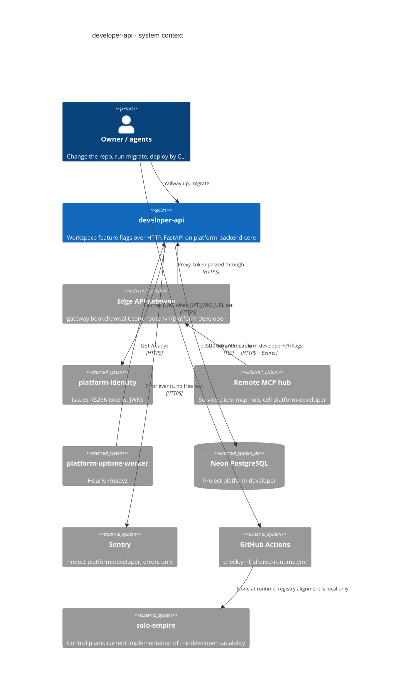

# 05 — C4 Context

ภาพรวมระบบ `developer-api` (feature-flag runtime pilot) กับคนและระบบรอบข้าง ภาพ C4 กลางของ portfolio อยู่ที่ [architecture-docs C4-DIAGRAMS.md](https://github.com/bookchaowalit/architecture-docs/blob/main/docs/architecture/C4-DIAGRAMS.md) (ไม่มีส่วนเฉพาะ developer)

Sources: ops record: api-gateway-edge (2026-11-03); `bookchaowalit-backend/platform-api-gateway@51c4711` `routes.json`; `bookchaowalit/platform-mcp-remote-worker@7d127c2` `wrangler.toml` `CELLS` + `src/worker.ts` `PLATFORM_CELLS`, `src/platform_developer/__main__.py`, `src/platform_developer/_sentry.py`, `src/platform_developer/app.py`, `.github/workflows/check.yml`, `.github/workflows/shared-runtime.yml`, `contract.json` (`current_implementation`), `scripts/check_registry_alignment.py`, ops record: book-platforms-status (2026-11-03) for Neon/Sentry/MCP hub/uptime/identity

## Open questions

- service ที่ deploy อยู่ตั้ง `JWT_JWKS_URL` ชี้ identity หรือ `JWT_PUBLIC_KEY` — ops record บอกว่าทุก service trust identity issuer แต่ `docs/runtime.md` staging plan ยังเขียน issuer `empire-platform`
- (ตอบแล้ว 2026-11-04) gateway มี route `platform-developer` และ MCP hub เรียกผ่าน gateway; direct Railway URL ยังเปิดอยู่ (service ไม่ตรวจ header ของ edge) — จะปิดเมื่อไร?
