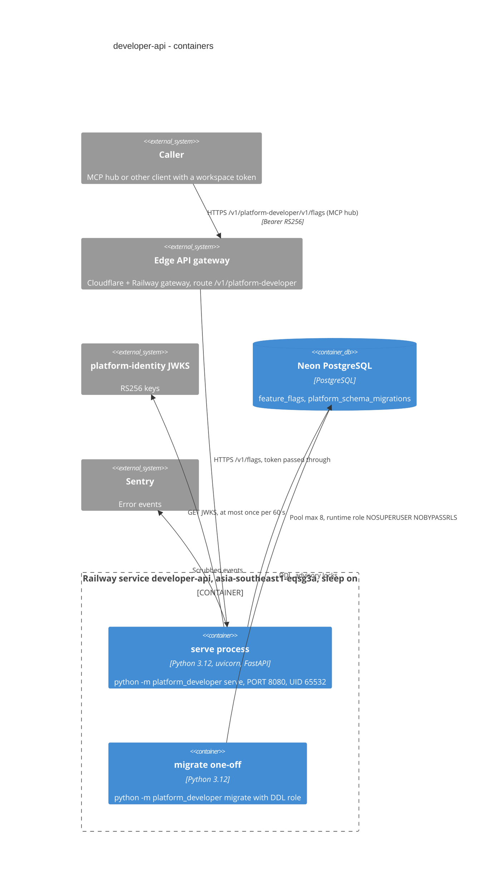

# 06 — C4 Container

Sources: ops record: api-gateway-edge (2026-11-03); `bookchaowalit-backend/platform-api-gateway@51c4711` `routes.json`; `bookchaowalit/platform-mcp-remote-worker@7d127c2` `wrangler.toml` `CELLS` + `src/worker.ts` `PLATFORM_CELLS`, `Dockerfile`, `.railway/railway.ts`, `src/platform_developer/__main__.py`, `src/platform_developer/migrations.py`, `src/platform_developer/_sentry.py`, core `platform_backend_core/db.py` (pool max_size 8, role check) and `auth.py` (JWKS refresh 60 s), `docs/runtime.md`, ops record: book-platforms-status (2026-11-03) for region/sleep/Neon

## Open questions

- migrate ถูกรันบน Railway เป็น one-off หรือรันจากเครื่อง owner — ops record deploy recipe บอกเพียง "migrate with the owner role"
