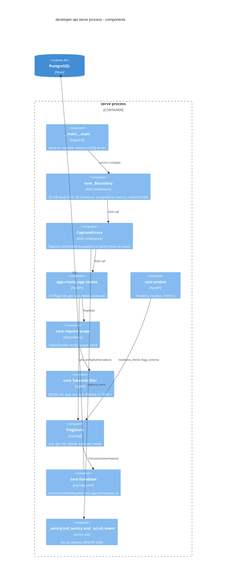

# 07 — C4 Component (serve process)

ลำดับ middleware: `_Boundary` (core, ชั้นนอก) → `CaptureErrors` (ชั้นในสุดของ user middleware) → FastAPI routes

Sources: `src/platform_developer/__main__.py`, `src/platform_developer/app.py`, `src/platform_developer/store.py`, `src/platform_developer/_sentry.py`, `src/platform_developer/__init__.py`, core `platform_backend_core/http.py`, `auth.py`, `db.py` (commit `21d5f44`)
