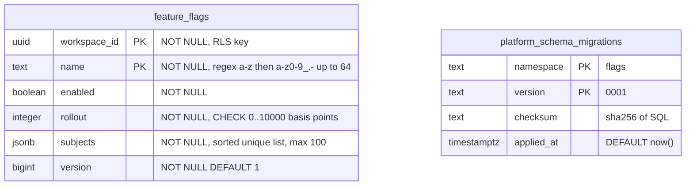

# 09 — ERD

Schema มาจาก migration `0001` (namespace `flags`) ของ repo นี้ และตาราง history ที่ core `MigrationRunner` สร้าง ทั้งสองตารางไม่มี foreign key ถึงกัน ภาพ ERD กลางของ portfolio: [architecture-docs ERD-DIAGRAMS.md](https://github.com/bookchaowalit/architecture-docs/blob/main/docs/architecture/ERD-DIAGRAMS.md) (ไม่มีส่วน developer)

Sources: `src/platform_developer/migrations.py`, `src/platform_developer/store.py` (validation), core `platform_backend_core/migrations.py` (history table DDL)

## RLS และ runtime role

| ตาราง | RLS | Policy | Runtime role grants (runtime.md) |
|---|---|---|---|
| `feature_flags` | ENABLE + FORCE | `workspace`: USING และ WITH CHECK `workspace_id = nullif(current_setting('app.workspace_id', true), '')::uuid` | SELECT, INSERT, UPDATE, DELETE |
| `platform_schema_migrations` | ไม่มี | — | SELECT เท่านั้น |
| schema `public` | — | — | USAGE |

runtime role ต้องเป็น NOSUPERUSER NOBYPASSRLS (core `Database._configure` ตรวจทุก connection) และ `FlagStore.ready` ตรวจแต่ละสิทธิ์แยกกัน

Sources: `src/platform_developer/migrations.py`, `src/platform_developer/store.py` (`ready`), core `platform_backend_core/db.py`, `docs/runtime.md`

## Open questions

- ชื่อ runtime role จริงบน Neon `platform-developer` (ops record ระบุชื่อ role ของ security และ payment แต่ไม่ระบุของ developer)
