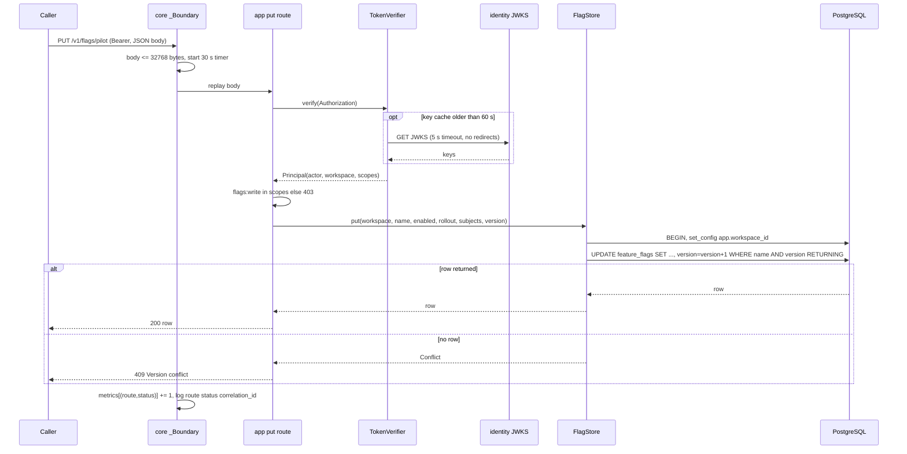
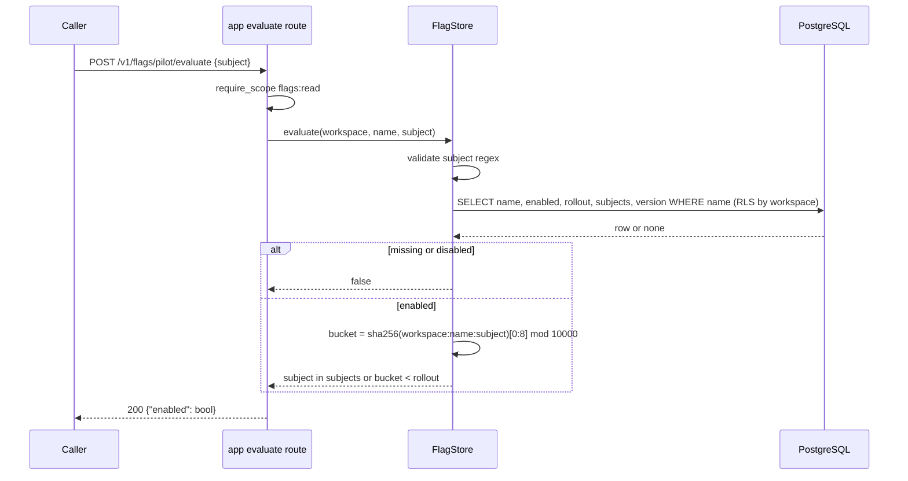
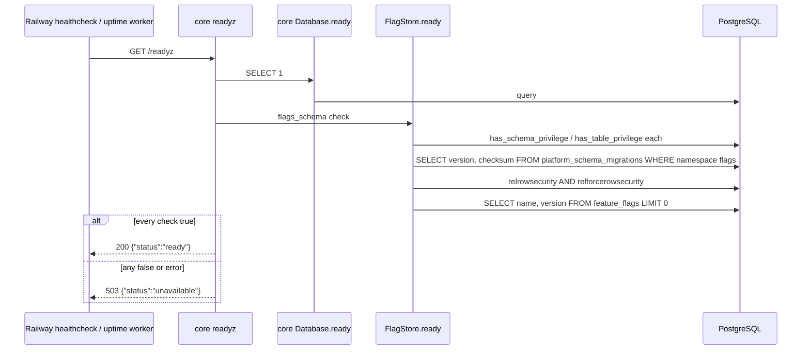
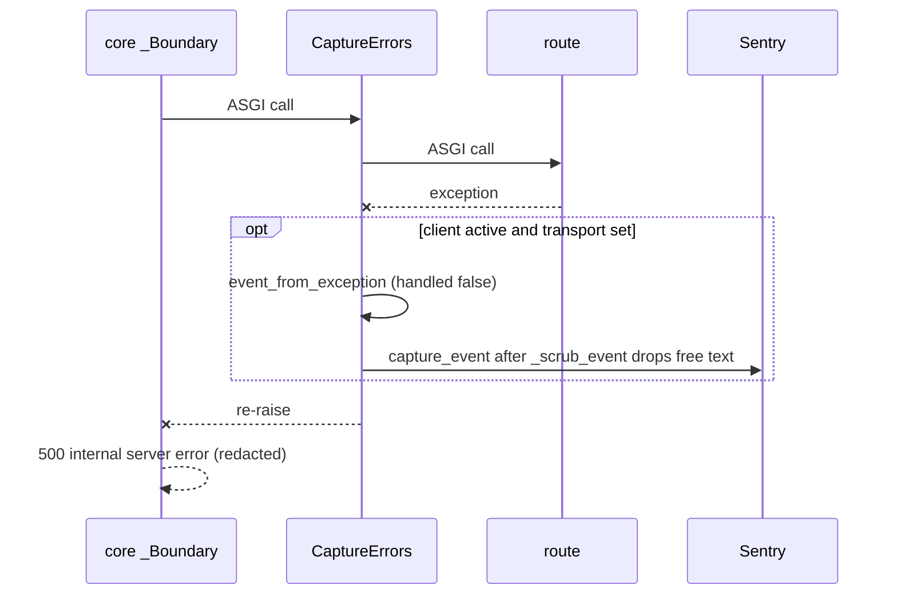

# 10 — Sequences

## 1. Update a flag (PUT with version)

## 2. Evaluate a flag

## 3. Readiness probe

## 4. Unhandled error to Sentry

Sources: `src/platform_developer/app.py`, `src/platform_developer/store.py`, `src/platform_developer/_sentry.py`, core `platform_backend_core/http.py`, `auth.py`, `db.py`, `runtime_tests/test_http.py`, `runtime_tests/test_sentry.py`
