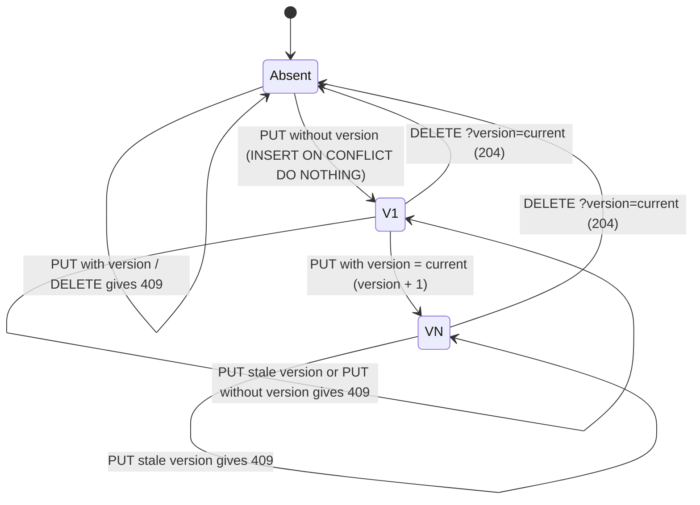
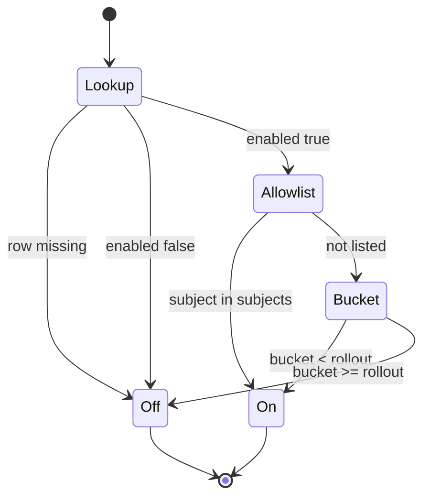
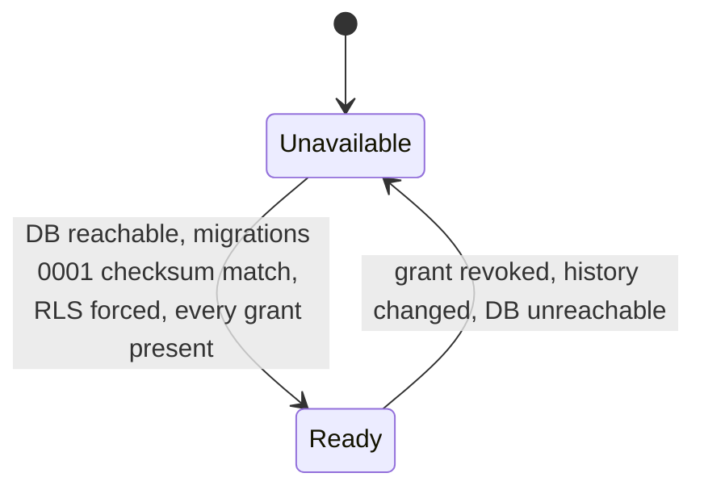

# 11 — State machines

`feature_flags` ไม่มีคอลัมน์ status แต่มี lifecycle ผ่าน `version` (optimistic concurrency) และ `enabled` / `rollout`

## Flag row lifecycle (version)

## Evaluation outcome per subject

## Service readiness

Sources: `src/platform_developer/store.py` (`put`, `delete`, `evaluate`, `ready`), `src/platform_developer/migrations.py`, `runtime_tests/test_runtime.py`, `runtime_tests/test_http.py`, `docs/runtime.md`
