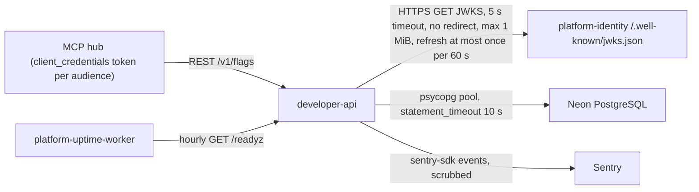

# 12 — API and integrations

API reference หลักอยู่ที่ [docs/runtime.md](../runtime.md) (Flag API) — reused; ตารางนี้สรุปจาก router code

## Routes

| Method | Path | Scope | Request | Success | Errors | Idempotency |
|---|---|---|---|---|---|---|
| GET | `/v1/flags` | `flags:read` | `limit` 1..100 (default 100), `after` ≤ 64 chars | 200 list sorted by name | 401, 403, 422 | safe read |
| GET | `/v1/flags/{name}` | `flags:read` | — | 200 row | 404 (missing / other workspace), 422 bad name | safe read |
| PUT | `/v1/flags/{name}` | `flags:write` | `enabled` bool, `rollout` 0..10000, `subjects` ≤ 100, `version` ≥ 1 optional; strict, extra fields forbidden | 200 row | 409 on create of an existing name or stale version, 422 | **not replay-idempotent**: no Idempotency-Key handling; repeating a create gives 409, repeating an update with the old version gives 409 (optimistic concurrency) |
| DELETE | `/v1/flags/{name}?version=N` | `flags:write` | `version` ≥ 1 required | 204 | 409 wrong version or missing, 422 | repeat gives 409 |
| POST | `/v1/flags/{name}/evaluate` | `flags:read` | `subject` 1..128 chars, regex `[A-Za-z0-9_:@.-]` | 200 `{"enabled": bool}` | 401, 403, 422 | pure function of stored row |
| GET | `/healthz` | none | — | 200 `{"status":"ok"}` | — | — |
| GET | `/readyz` | none | — | 200 ready | 503 unavailable | — |
| GET | `/metrics` | none | — | 200 Prometheus text | — | — |

ทุก route: body ≤ 32768 bytes (413), timeout 30 s (504), unexpected error → 500 redacted, response มี header `x-request-id`

Sources: `src/platform_developer/app.py`, `src/platform_developer/store.py`, core `platform_backend_core/http.py`, `runtime_tests/test_http.py` (tests ส่ง `Idempotency-Key` header แต่ไม่มีโค้ดอ่านมัน)

## External integrations

Sources: core `platform_backend_core/auth.py` (`_JWKS`), `db.py`, `src/platform_developer/_sentry.py`, ops record: book-platforms-status (2026-11-03) for identity JWKS URL, MCP hub and uptime worker

ไม่มี webhook, ไม่มี event bus, ไม่มี provider SDK อื่นในโค้ด (`pyproject.toml` dependencies: platform-backend-core, uvicorn, sentry-sdk, httpx)

## Contract interfaces (legacy boundary)

5 interfaces ใน `contract.json` (workflow/config ใน solo-empire) — reused: [docs/CONTRACT-SURFACE.md](../CONTRACT-SURFACE.md)

## Open questions

- identity audience ของ service นี้ (deploy recipe บอก pattern `<svc>-api` แต่ไม่มีบรรทัดที่ยืนยันชื่อ `developer-api`)
- ต้องการ Idempotency-Key จริงสำหรับ PUT create หรือไม่ (ปัจจุบันพึ่ง 409 + version)
