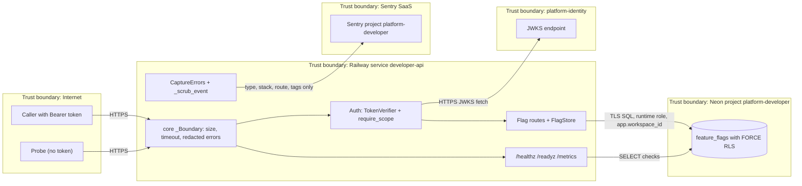

# 13 — Threat model (DFD + STRIDE)

ภาพ attack path กลาง: [architecture-docs ATTACK-PATH-DIAGRAMS.md](https://github.com/bookchaowalit/architecture-docs/blob/main/docs/architecture/ATTACK-PATH-DIAGRAMS.md) (ไม่มีส่วน developer)

## DFD with trust boundaries

Sources: core `platform_backend_core/http.py`, `auth.py`, `db.py`; `src/platform_developer/app.py`, `store.py`, `migrations.py`, `_sentry.py`; ops record: book-platforms-status (2026-11-03) for Neon/Sentry/identity

หมายเหตุ: ไม่พบหลักฐานว่า developer อยู่หลัง edge gateway (`X-Gateway-Edge` origin lock) จึงวาด caller เข้าตรงที่ Railway domain — ดู Open questions

## STRIDE per element

| Element | Threat | Existing mitigation (code) | Gap |
|---|---|---|---|
| Caller → API | **S**poofing | RS256 only, issuer + audience, required claims, lifetime ≤ 3600 s, reject `del`/`obo`, `crit` (`auth.py`) | no revocation / jti replay store |
| Caller → API | **T**ampering | JWT signature; Pydantic `strict`, `extra='forbid'`; identifier/subject regex (`app.py`, `store.py`) | — |
| Caller → API | **R**epudiation | log `route status correlation_id`, `x-request-id` (`http.py`) | actor (`sub`) not logged, no audit trail of flag changes (runtime.md: audit history not done) |
| Flag data | **I**nformation disclosure | workspace from `ws` only; FORCE RLS; cross-workspace = 404 (`migrations.py`, `db.py`, tests) | — |
| Flag data | **T**ampering | WITH CHECK policy; exact-version updates (`store.py`) | — |
| API | **D**enial of service | body ≤ 32 KiB, 30 s timeout, `limit_concurrency=100`, pool 8, `max_waiting` 64, statement_timeout 10 s | no rate limit per caller in code |
| API | **E**levation of privilege | per-route scope; runtime role NOSUPERUSER NOBYPASSRLS enforced by `_configure`; readiness checks grants | — |
| `/metrics`, `/readyz` | **I**nformation disclosure | route templates only, no paths/queries (`http.py`) | unauthenticated; exposes route/status counts publicly |
| JWKS fetch | **S**poofing / **T**ampering | HTTPS required, no redirects, ≤ 1 MiB, ≤ 64 keys, RSA RS256 sig only, kid unique (`auth.py`) | — |
| JWKS fetch | **D**oS | refresh at most once per 60 s; failed refresh empties cache (fail closed) | identity outage = 401 for up to 60 s+ |
| Sentry egress | **I**nformation disclosure | no free text, no locals, no PII, no tracing, no request body/headers (`_sentry.py`, `test_sentry.py`) | — |
| Config / secrets | **I**nformation disclosure | config errors exit with fixed text (`__main__.py`); env only, no files; `.dockerignore` excludes `.env*` | — |
| Build supply chain | **T**ampering | core pinned to commit; actions SHA-pinned; non-root image (`Dockerfile`, `test_build_hygiene.py`); CI security workflow | base image `python:3.12-slim` not digest-pinned |
| Repo `main` | **T**ampering | CI on push/PR | no branch protection / rulesets (BOO-155 doc, checked 2026-10-16) |

Sources: เดียวกับด้านบน + `.github/workflows/check.yml`, `Dockerfile`, `.dockerignore`, `docs/gates/BOO-155-template-independence.md`, `runtime_tests/test_sentry.py`

## Open questions

- service อยู่หลัง `gateway.bookchaowalit.com` หรือเปิดตรงบน Railway domain
- Railway domain สาธารณะของ `/metrics` ควรปิดหรือไม่
- `JWT_AUDIENCE` จริงของ deployment
