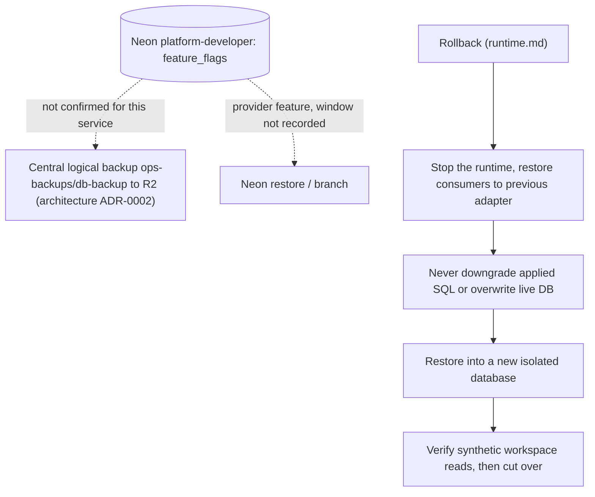

# 14 — Backup and DR

## ข้อมูลที่มี

| Data | Where | Persisted? | Source |
|---|---|---|---|
| `feature_flags` rows (per workspace) | Neon project `platform-developer` | yes | `src/platform_developer/migrations.py`, ops record |
| `platform_schema_migrations` | same database | yes | core `migrations.py` |
| HTTP metrics counters | process memory | no, reset on restart/sleep | core `http.py` |
| Secrets (DATABASE_URL, JWT config, SENTRY_DSN) | Infisical `/platform-developer` + Railway variables | managed outside repo | ops record |

## Backup / restore reality

Sources: `docs/runtime.md` (Verification and release gate, Staging plan step 4), [architecture-docs ADR-0002 production baseline](https://github.com/bookchaowalit/architecture-docs/blob/main/docs/architecture/decisions/ADR-0002-production-baseline-monitoring-backups.md), ops record: book-platforms-status (2026-11-03)

- ใน repo ไม่มี backup workflow หรือ script: `docs/runtime.md` บอกว่า "Runtime role and backup/restore provisioning remain operator release work" และ "no scheduled deletion or backup credential access is implemented here"
- Staging plan step 4 (rollback drill: restore backup ไป database ใหม่) — ไม่พบบันทึกว่าทำแล้ว
- **RTO: not defined. RPO: not defined.**

## Open questions

- Neon `platform-developer` อยู่ใน target list ของ `ops-backups/db-backup` และมี `db_backup` role แล้วหรือยัง
- เคยทำ restore drill ของ developer หรือไม่
- Neon free plan restore window ของ project นี้
- กำหนด RTO/RPO (flag data เล็ก แต่ถ้า consumer พึ่ง evaluate การหายของ row = flag off)
