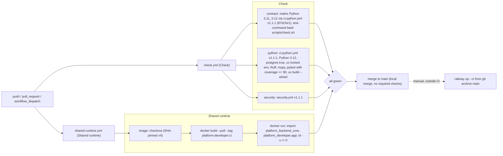

# 15 — CI/CD pipeline

สอง workflow ทั้งคู่ trigger `push` (ทุก branch), `pull_request`, `workflow_dispatch`; `permissions: contents: read`; concurrency cancel-in-progress ต่อ ref ไม่มี job ใด deploy

Sources: `.github/workflows/check.yml`, `.github/workflows/shared-runtime.yml`, `scripts/check.sh`, `pyproject.toml` (`[tool.mypy]`, `[tool.coverage.run]`), `docs/gates/BOO-155-template-independence.md` (no branch protection), ops record: book-platforms-status (2026-11-03) deploy recipe

ไม่มี `needs:` ระหว่าง job — ทุก job รันขนานกัน รายละเอียด step ภายใน `ci-python.yml` / `security.yml` อยู่ใน repo `bookchaowalit/platform-ci-workflows` (ไม่ได้อ่านใน pack นี้) ข้อความ "uv locked env, Ruff, mypy" มาจาก comment ใน `check.yml`

## Open questions

- ขั้นตอนที่แน่นอนของ reusable `security.yml` (gitleaks ถูกกล่าวถึงใน `docs/runtime.md`)
- ทำไม Railway ไม่ได้ต่อกับ GitHub (push=deploy) สำหรับ service นี้
