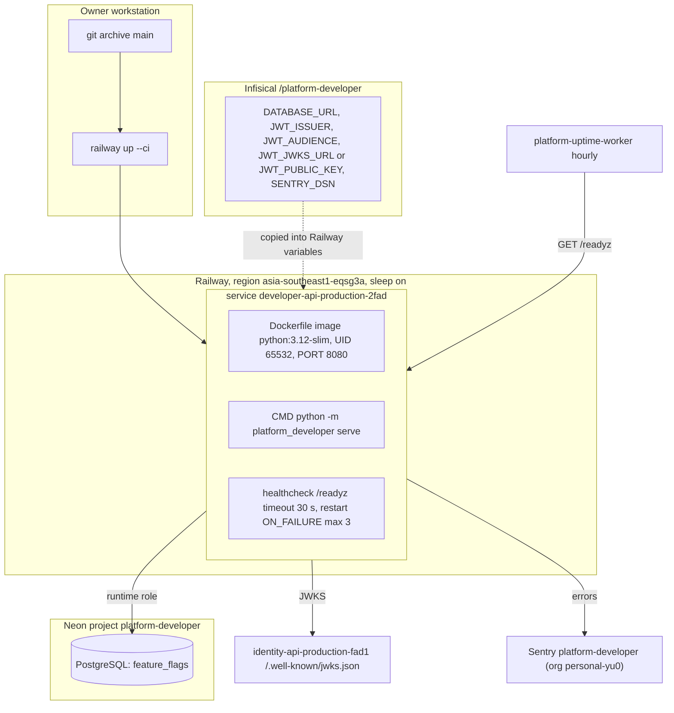

# 16 — Deployment

Sources: `railway.toml`, `Dockerfile`, `src/platform_developer/__main__.py` (env names), `src/platform_developer/_sentry.py` (`SENTRY_DSN`, `SENTRY_ENVIRONMENT`, `RAILWAY_GIT_COMMIT_SHA`, `RAILWAY_SERVICE_NAME`), `docs/runtime.md`, ops record: book-platforms-status (2026-11-03) for service name, region, sleep, Neon, Infisical, Sentry, identity issuer, uptime worker, CLI deploy of main `6ffbb1f`

| Item | Value | Evidence |
|---|---|---|
| Health | `/healthz` 200 always; `/readyz` 200/503 | core `http.py` |
| Concurrency | uvicorn `limit_concurrency=100`; DB pool max 8 | `__main__.py`, core `db.py` |
| Cold start | Neon resume ~6–9 s; pool wait 20 s, connect 15 s | core `db.py` comment, ops record |
| Release tag in Sentry | `RAILWAY_GIT_COMMIT_SHA` or `SENTRY_RELEASE`, else none | `_sentry.py` |

## Doc drift

`README.md`, `PRODUCT.md` และ `docs/runtime.md` ยังเขียนว่า runtime "not deployed" / staging plan "not executed" แต่ ops record (2026-11-03) บันทึกว่า live และ `/readyz` 200 ต้องอัปเดตเอกสารเหล่านั้นใน change แยก (pack นี้แก้เฉพาะ `docs/diagrams/`)

## Open questions

- hostname เต็ม (custom domain หรือ `*.up.railway.app`) และอยู่หลัง edge gateway หรือไม่
- CLI upload ไม่มี git SHA: `RAILWAY_GIT_COMMIT_SHA` ว่าง → Sentry ไม่มี release ยกเว้นตั้ง `SENTRY_RELEASE` เอง
- `JWT_JWKS_URL` หรือ `JWT_PUBLIC_KEY` ที่ตั้งจริง
