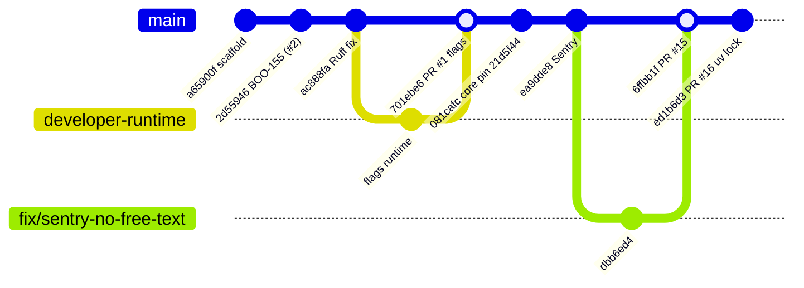
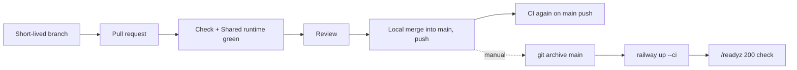

# 18 — Git and release workflow

จาก history: งานทำบน branch สั้น (`fix/sentry-*`, `ci/uv-lock-mypy`, `boo-155-*`) → PR → CI → merge แบบ merge commit "Merge PR #N" เข้า `main` แล้ว deploy ด้วย CLI จาก `main` ไม่มี tag หรือ GitHub release

Sources: `git log --first-parent origin/main` (2026-09-17 → 2026-11-03), `gh pr list -R bookchaowalit-backend/platform-developer --state all`, `.github/workflows/check.yml`, `.github/workflows/shared-runtime.yml`, ops record: book-platforms-status (2026-11-03) deploy recipe

หมายเหตุ: PR #1 ถูก **close** (ไม่ merge) แล้ว rebase เป็น branch `developer-runtime` และ merge เข้า main เป็น `701ebe6` (`docs/runtime.md` Verification 2026-10-29) ส่วน PR #4 (`sentry-hardened-scrubber`) ยัง open แต่ถูกแทนด้วย PR #5–#15

## Open questions

- `main` ไม่มี branch protection / required checks (BOO-155 owner follow-up)
- ควรปิด PR #4 ที่ superseded หรือไม่
- ไม่มีวิธีผูก deploy กับ commit ใน git (ไม่มี tag, ไม่มี deploy record ใน repo)
