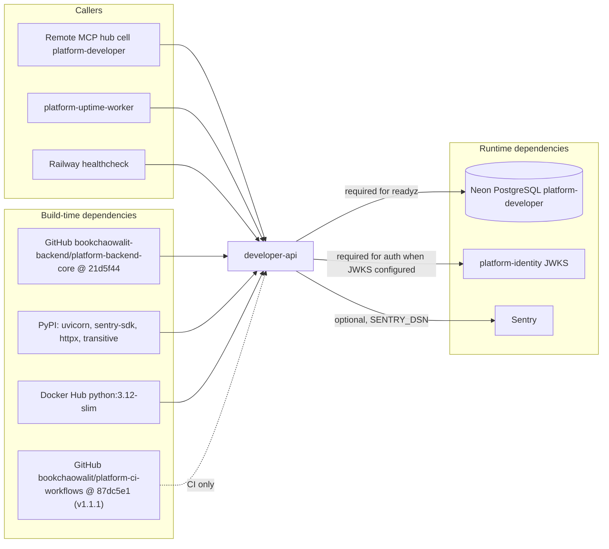

# 19 — Service dependency map

| Dependency | Failure effect | Evidence |
|---|---|---|
| Neon | `/readyz` 503; API calls 500 (redacted) | core `db.py`, `http.py` |
| identity JWKS | token verification fails → 401 (fail closed) | core `auth.py` |
| Sentry | none on requests (SDK async) | `_sentry.py` |
| contract deps `security`, `observability` | declared in `contract.json` `depends_on`; no runtime call in code | `contract.json`, `src/` |

Sources: `pyproject.toml`, `Dockerfile`, `.github/workflows/check.yml`, `src/platform_developer/*.py`, core `platform_backend_core/*.py`, `contract.json`, ops record: book-platforms-status (2026-11-03) for MCP hub, uptime worker, Neon, identity

## Open questions

- มี service อื่น (นอกจาก MCP hub) เรียก developer-api หรือไม่
