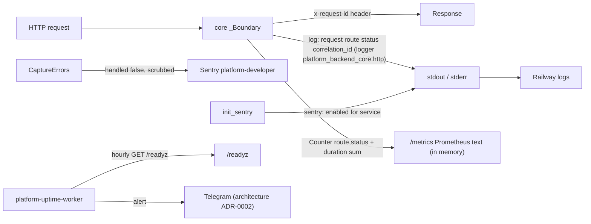

# 20 — Observability

| Signal | Emitted by | Watched by | Evidence |
|---|---|---|---|
| Error events (type, stack, route, tags, release) | `CaptureErrors` + Sentry FastAPI integration | Sentry project `platform-developer` | `_sentry.py`, `app.py`, ops record |
| Startup line `sentry: enabled for <service>` | `init_sentry` | Railway logs (seen at deploy, ops record) | `_sentry.py` |
| Request log `route status correlation_id` | core `_Boundary` | Railway logs; no log drain found | core `http.py` |
| `platform_http_requests_total`, `platform_http_request_duration_seconds_sum` | `/metrics` | **nobody found** (observability repo is a library, scraper decision open, ops record) | core `http.py` |
| `/readyz` | core + `FlagStore.ready` | Railway healthcheck, uptime worker hourly | `railway.toml`, ops record |
| Traces | disabled (`traces_sample_rate=None`) | — | `_sentry.py` |
| Product analytics | none | — | no SDK in `pyproject.toml` |

Sources: core `platform_backend_core/http.py`, `src/platform_developer/_sentry.py`, `src/platform_developer/app.py`, `railway.toml`, `pyproject.toml`, ops record: book-platforms-status (2026-11-03), [architecture-docs ADR-0002](https://github.com/bookchaowalit/architecture-docs/blob/main/docs/architecture/decisions/ADR-0002-production-baseline-monitoring-backups.md)

หมายเหตุ: Python logging ไม่ได้ตั้ง handler ใน repo นี้ และ uvicorn `access_log=False` — บรรทัด `request route=...` ระดับ INFO อาจไม่ออกเลยถ้า root logger อยู่ที่ WARNING (ไม่ได้ตรวจใน production)

## Open questions

- Sentry alert rule ของ project `platform-developer` ตั้งไว้อย่างไร ส่งไปไหน
- request log ระดับ INFO ออกใน Railway จริงหรือไม่
- metrics ในหน่วยความจำหายทุกครั้งที่ service sleep — ต้องการ scraper หรือไม่ (owner decision ใน ops record)
