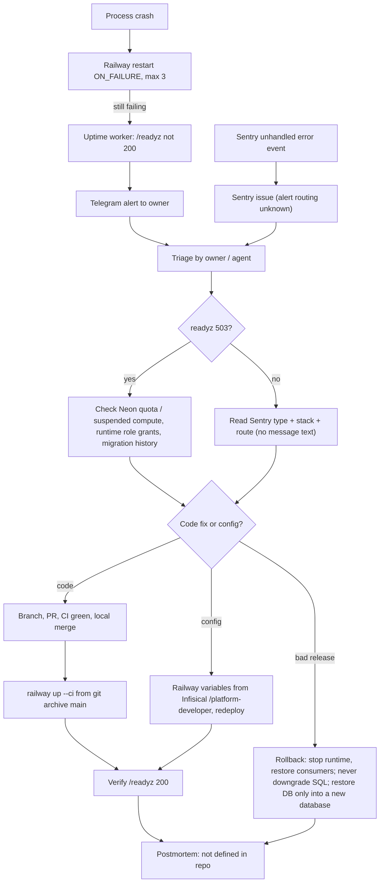

# 21 — Incident response

ช่องทาง alert ที่พบ: (1) platform-uptime-worker ตรวจ `/readyz` รายชั่วโมงและแจ้ง Telegram (ADR-0002 กลาง + ops record), (2) Sentry project `platform-developer` (ops record), (3) Railway restart อัตโนมัติ `ON_FAILURE` สูงสุด 3 ครั้ง (`.railway/railway.ts`) ไม่มี runbook เฉพาะ service ใน repo — ขั้น rollback มาจาก `docs/runtime.md`

Sources: `.railway/railway.ts`, `docs/runtime.md` (Verification and release gate, rollback), `src/platform_developer/_sentry.py`, `src/platform_developer/store.py` (`ready`), [architecture-docs ADR-0002](https://github.com/bookchaowalit/architecture-docs/blob/main/docs/architecture/decisions/ADR-0002-production-baseline-monitoring-backups.md), ops record: book-platforms-status (2026-11-03) (uptime target, Sentry project, deploy recipe, Neon quota note)

## Open questions

- Sentry alert ไปที่ช่องทางใด (email / Telegram)
- มี postmortem template หรือที่เก็บ incident record สำหรับ platform services หรือไม่
- ไม่มี on-call / severity definition ใน repo
