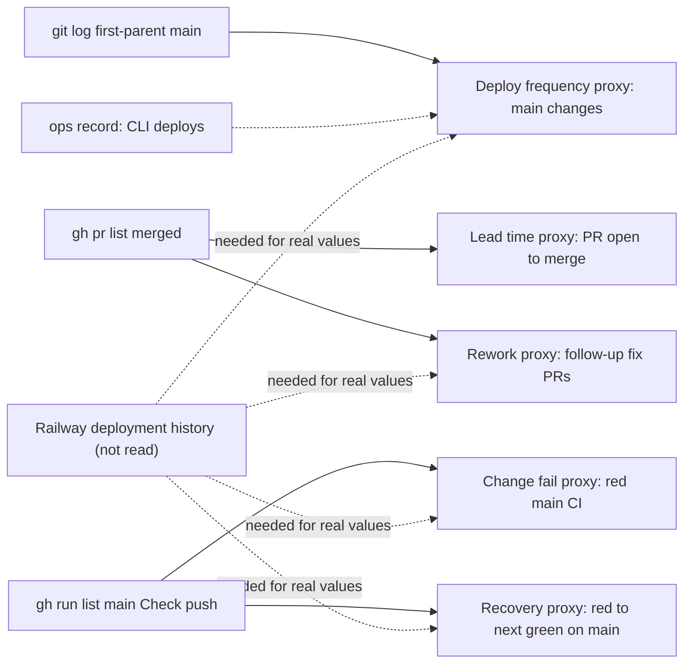

# 22 — DORA metrics

ช่วงวัด: 90 วันถึง 2026-11-03 (`--since=2026-08-05`) ข้อจำกัดหลัก: service นี้ deploy ด้วย **CLI `railway up --ci` จาก `git archive main`** (ops record) จึงไม่มี deploy event ใน git, GitHub Actions หรือ GitHub Deployments และ `RAILWAY_GIT_COMMIT_SHA` ว่างสำหรับ CLI upload ตัวเลขด้านล่างจึงเป็น **proxy จากฝั่ง git/CI** เว้นแต่ระบุไว้

Sources: `git log`, `gh pr list`, `gh run list` (commands below), ops record: book-platforms-status (2026-11-03)

| Metric | How to measure for this repo | Current value (proxy) | Command |
|---|---|---|---|
| Deployment frequency | Railway deployment list for `developer-api-production-2fad` | **cannot compute from git/gh.** Known deploys in ops record: initial live by 2026-10-29, redeploy of main `6ffbb1f` on 2026-11-03. Proxy: 31 first-parent commits to `main` on 10 distinct days | `git rev-list --count --first-parent --since=2026-08-05 origin/main`; `git log --first-parent --since=2026-08-05 --format=%ad --date=short origin/main \| sort -u \| wc -l` |
| Lead time for changes | commit time → Railway deploy time | **commit→deploy cannot compute.** Proxy PR open→merge: n=14 merged PRs, median 6.1 min, min 3.2 min, max 34.8 min | `gh pr list -R bookchaowalit-backend/platform-developer --state merged --limit 50 --json createdAt,mergedAt` |
| Change fail rate | deploys that needed a fix or rollback / all deploys | **cannot compute** (no deploy records). Proxy: `Check` on `main` push 3 failed of 27 runs = 11% (`7b60280`, `c96e0e6` on 2026-10-13; `4f433a8` on 2026-10-22) | `gh run list -R bookchaowalit-backend/platform-developer --branch main --workflow Check --event push --created '>=2026-08-05' --json conclusion` |
| Failed deployment recovery time | failed deploy → healthy deploy | **cannot compute.** Proxy red main → next green: `4f433a8` 09:41:45Z → `ac888fa` 09:45:00Z (≈3 min); `7b60280` 03:35:44Z → `23dbeb9` 05:37:32Z (≈2 h) | `gh run list ... --branch main --workflow Check --json headSha,conclusion,createdAt,updatedAt` |
| Deployment rework rate | unplanned deploys that fix a previous deploy / all deploys | **cannot compute per deploy.** Proxy: 9 of 14 merged PRs (#6–#14, 2026-11-02/03) were follow-up fixes to the Sentry scrubber from PR #5, then replaced by PR #15 | `gh pr list ... --state merged --json number,title,mergedAt` |

## วิธีทำให้วัดได้จริง

- อ่าน Railway deployment history (GraphQL `deployments` ของ service) แล้วจับคู่กับ SHA ที่ deploy — ต้องบันทึก SHA เอง เพราะ CLI upload ไม่ส่ง git metadata
- หรือย้าย deploy เข้า GitHub Actions / GitHub-connected Railway source เพื่อให้มี event ต่อ commit

## Open questions

- PR #5–#14 ถูก deploy ทีละตัวหรือเฉพาะ `6ffbb1f` (ops record บอกเฉพาะ `6ffbb1f`)
- ต้องการให้ DORA ของ platform services ดึงจาก Railway API หรือไม่
